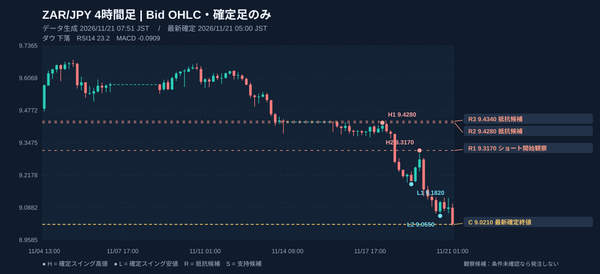

# FX 5時間足 データ確認（2026/11/17 07:52 JST）
取得元：Dukascopy via dukascopy-node (Bid OHLC)。口座情報は未連携。実際の売買価格は各社のBid/Askを使用してください。
確定足のみ使用。4時間足・日足はUTC区切り、週足は月曜日UTCで日足から集計。

## ZAR/JPY（みんなのFX）

**注釈付き4時間足チャート（重要高安値・支持・抵抗を書き込み）**

**全5時間足の注釈チャート**：[15分](./charts/zarjpy_m15.svg) / [1時間](./charts/zarjpy_h1.svg) / [4時間](./charts/zarjpy_h4.svg) / [日足](./charts/zarjpy_d1.svg) / [週足](./charts/zarjpy_w1.svg)
- m15：最新確定 2026/11/17 07:45 JST、終値 9.3830、ダウ 下落、RSI14 43.4、MACD -0.0042 / signal -0.0042、直近高値 9.3980 / 9.3950、直近安値 9.3830 / 9.3730、支持候補 9.3810 / 9.3750 / 9.3730、抵抗候補 9.3950 / 9.3980 / 9.4150
- h1：最新確定 2026/11/17 07:00 JST、終値 9.3890、ダウ 下落、RSI14 37.2、MACD -0.0093 / signal -0.0078、直近高値 9.4340 / 9.4310、直近安値 9.3840 / 9.3750、支持候補 9.3850 / 9.3840 / 9.3810、抵抗候補 9.4310 / 9.4340 / 9.4520
- h4：最新確定 2026/11/17 05:00 JST、終値 9.3920、ダウ 下落、RSI14 19.9、MACD -0.0337 / signal -0.0353、直近高値 9.5510 / 9.4340、直近安値 9.3850 / 9.3810、支持候補 9.3850 / 9.3810、抵抗候補 9.4340 / 9.4730 / 9.4990
- d1：最新確定 2026/11/16 09:00 JST、終値 9.4300、ダウ 下落、RSI14 41.4、MACD -0.0128 / signal -0.0002、直近高値 9.6800 / 9.6660、直近安値 9.3940 / 9.3850、支持候補 9.4290 / 9.4200 / 9.4000、抵抗候補 9.5190 / 9.5870 / 9.5980
- w1：最新確定 2026/11/16 09:00 JST、終値 9.4300、ダウ 下落、RSI14 44.6、MACD -0.0376 / signal 0.0039、直近高値 10.0120 / 10.0000、直近安値 9.4200 / 9.4000、支持候補 9.4200 / 9.4000 / 9.2830、抵抗候補 9.7730 / 9.8810 / 9.8920

## USD/JPY（GMOクリック証券）

**注釈付き4時間足チャート（重要高安値・支持・抵抗を書き込み）**

**全5時間足の注釈チャート**：[15分](./charts/usdjpy_m15.svg) / [1時間](./charts/usdjpy_h1.svg) / [4時間](./charts/usdjpy_h4.svg) / [日足](./charts/usdjpy_d1.svg) / [週足](./charts/usdjpy_w1.svg)
- m15：最新確定 2026/11/17 07:45 JST、終値 159.424、ダウ 上昇、RSI14 43.8、MACD -0.030 / signal -0.029、直近高値 159.495 / 159.501、直近安値 159.362 / 159.388、支持候補 159.388 / 159.381 / 159.367、抵抗候補 159.495 / 159.501 / 159.580
- h1：最新確定 2026/11/17 07:00 JST、終値 159.438、ダウ 下落、RSI14 41.1、MACD -0.047 / signal -0.038、直近高値 159.694 / 159.671、直近安値 159.432 / 159.362、支持候補 159.432 / 159.367 / 159.362、抵抗候補 159.671 / 159.694 / 159.836
- h4：最新確定 2026/11/17 05:00 JST、終値 159.475、ダウ 下落、RSI14 45.1、MACD 0.050 / signal 0.112、直近高値 160.189 / 159.890、直近安値 159.519 / 159.348、支持候補 159.348 / 159.308 / 158.663、抵抗候補 159.489 / 159.526 / 159.544
- d1：最新確定 2026/11/16 09:00 JST、終値 159.789、ダウ 上昇、RSI14 65.2、MACD 0.524 / signal 0.342、直近高値 158.766 / 160.189、直近安値 157.253 / 157.669、支持候補 157.701 / 157.669 / 157.548、抵抗候補 160.189 / 160.203 / 160.392
- w1：最新確定 2026/11/16 09:00 JST、終値 159.789、ダウ 混在・転換・レンジ、RSI14 55.3、MACD -0.092 / signal -0.121、直近高値 159.034 / 158.948、直近安値 152.889 / 156.074、支持候補 156.074 / 155.225 / 155.029、抵抗候補 160.392 / 160.460 / 160.723

口座残高・建玉・必要証拠金・ロスカット水準は自動取得しません。
