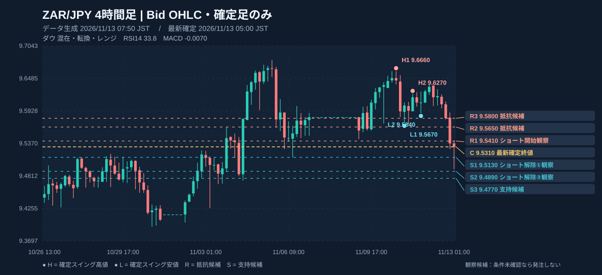
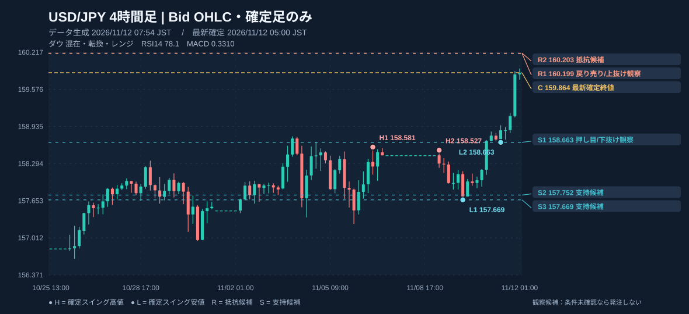

# FX 5時間足 データ確認（2026/11/12 07:54 JST）
取得元：Dukascopy via dukascopy-node (Bid OHLC)。口座情報は未連携。実際の売買価格は各社のBid/Askを使用してください。
確定足のみ使用。4時間足・日足はUTC区切り、週足は月曜日UTCで日足から集計。

## ZAR/JPY（みんなのFX）

**注釈付き4時間足チャート（重要高安値・支持・抵抗を書き込み）**

**全5時間足の注釈チャート**：[15分](./charts/zarjpy_m15.svg) / [1時間](./charts/zarjpy_h1.svg) / [4時間](./charts/zarjpy_h4.svg) / [日足](./charts/zarjpy_d1.svg) / [週足](./charts/zarjpy_w1.svg)
- m15：最新確定 2026/11/12 07:45 JST、終値 9.6050、ダウ 混在・転換・レンジ、RSI14 27.6、MACD -0.0034 / signal 0.0003、直近高値 9.6270 / 9.6350、直近安値 9.6250 / 9.6010、支持候補 9.6020 / 9.6010 / 9.6000、抵抗候補 9.6140 / 9.6180 / 9.6230
- h1：最新確定 2026/11/12 07:00 JST、終値 9.6270、ダウ 混在・転換・レンジ、RSI14 54.8、MACD 0.0047 / signal 0.0028、直近高値 9.6270 / 9.6250、直近安値 9.5840 / 9.6060、支持候補 9.6060 / 9.5840 / 9.5710、抵抗候補 9.6320 / 9.6370 / 9.6420
- h4：最新確定 2026/11/12 05:00 JST、終値 9.6340、ダウ 混在・転換・レンジ、RSI14 58.6、MACD 0.0104 / signal 0.0110、直近高値 9.6660 / 9.6270、直近安値 9.5670 / 9.5840、支持候補 9.5940 / 9.5840 / 9.5710、抵抗候補 9.6390 / 9.6540 / 9.6580
- d1：最新確定 2026/11/11 09:00 JST、終値 9.5930、ダウ 混在・転換・レンジ、RSI14 54.4、MACD 0.0156 / signal -0.0009、直近高値 9.5190 / 9.6800、直近安値 9.4890 / 9.3940、支持候補 9.5780 / 9.5570 / 9.5540、抵抗候補 9.5980 / 9.6250 / 9.6390
- w1：最新確定 2026/11/09 09:00 JST、終値 9.5590、ダウ 下落、RSI14 48.6、MACD -0.0262 / signal 0.0159、直近高値 10.0120 / 10.0000、直近安値 9.4200 / 9.4000、支持候補 9.4790 / 9.4200 / 9.4000、抵抗候補 9.7730 / 9.8810 / 9.8920

## USD/JPY（GMOクリック証券）

**注釈付き4時間足チャート（重要高安値・支持・抵抗を書き込み）**

**全5時間足の注釈チャート**：[15分](./charts/usdjpy_m15.svg) / [1時間](./charts/usdjpy_h1.svg) / [4時間](./charts/usdjpy_h4.svg) / [日足](./charts/usdjpy_d1.svg) / [週足](./charts/usdjpy_w1.svg)
- m15：最新確定 2026/11/12 07:45 JST、終値 159.663、ダウ 混在・転換・レンジ、RSI14 39.3、MACD 0.019 / signal 0.060、直近高値 159.900 / 159.886、直近安値 159.820 / 159.829、支持候補 159.095 / 158.824 / 158.780、抵抗候補 159.886 / 159.893 / 159.900
- h1：最新確定 2026/11/12 07:00 JST、終値 159.778、ダウ 上昇、RSI14 79.5、MACD 0.339 / signal 0.309、直近高値 158.958 / 159.938、直近安値 158.663 / 158.709、支持候補 158.709 / 158.663 / 158.168、抵抗候補 159.938
- h4：最新確定 2026/11/12 05:00 JST、終値 159.864、ダウ 混在・転換・レンジ、RSI14 78.1、MACD 0.331 / signal 0.159、直近高値 158.581 / 158.527、直近安値 157.669 / 158.663、支持候補 158.663 / 157.752 / 157.669、抵抗候補 160.199 / 160.203 / 160.392
- d1：最新確定 2026/11/11 09:00 JST、終値 158.711、ダウ 上昇、RSI14 58.4、MACD 0.183 / signal 0.111、直近高値 158.345 / 158.766、直近安値 156.963 / 157.253、支持候補 158.026 / 157.701 / 157.548、抵抗候補 158.766 / 158.948 / 159.034
- w1：最新確定 2026/11/09 09:00 JST、終値 158.297、ダウ 混在・転換・レンジ、RSI14 50.8、MACD -0.261 / signal -0.124、直近高値 159.034 / 158.948、直近安値 152.889 / 156.074、支持候補 156.074 / 155.225 / 155.029、抵抗候補 158.948 / 159.034 / 159.452

口座残高・建玉・必要証拠金・ロスカット水準は自動取得しません。
