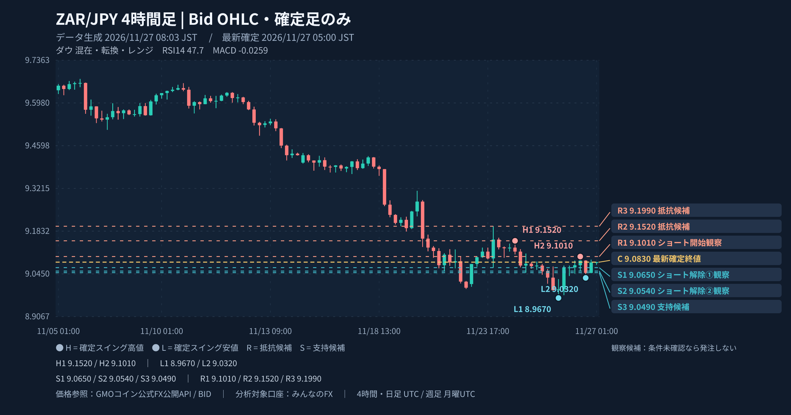
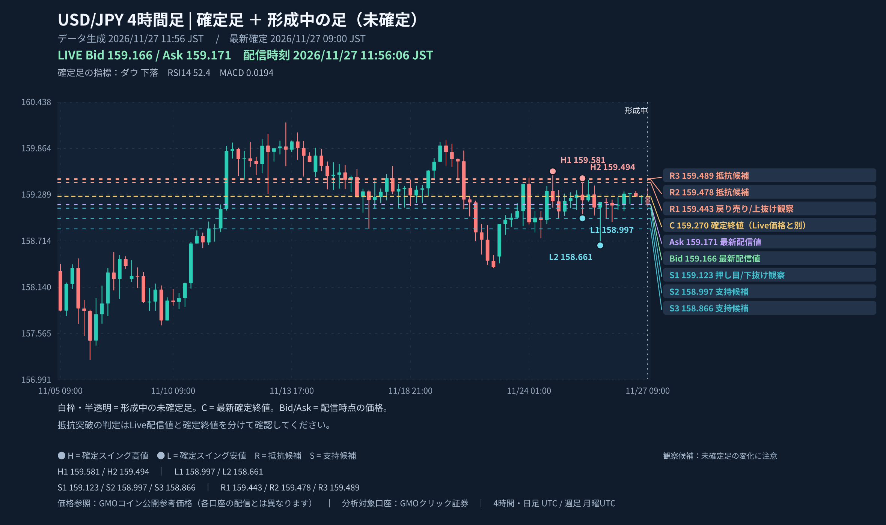

# FX最新スナップショット

生成: 2026-11-27T02:56:06.810Z（2026-11-27 11:56:06 JST）

GMOコインの公開参照価格です。ZAR/JPYの分析対象口座はみんなのFX、USD/JPYはGMOクリック証券であり、両口座の配信価格・口座情報ではありません。確定足と形成中の足・取得時点のBid/Askを明確に分離しています。画像は生成時点のスナップショットで連続更新画像ではありません。

確定指標は確定足のみ。形成足は未確定です。観察点は条件確認前の発注条件です。UTC基準4時間・日足、週足は月曜00:00 UTC。業者の足区切り・配信値との差があります。

## ZAR/JPY｜みんなのFX

最新配信 2026-11-27 11:56:06 JST：**Bid 9.130 / Ask 9.139**。

|足|最新確定時刻 JST|確定終値|確定スイング構造|RSI14|MACD / Signal / Hist|
|---|---|---:|---|---:|---|
|m15|2026-11-27 11:45:00 JST|9.132|上昇|80.66|0.01220 / 0.00639 / 0.00581|
|h1|2026-11-27 11:00:00 JST|9.107|混在・転換・レンジ|62.17|0.00719 / 0.00566 / 0.00153|
|h4|2026-11-27 09:00:00 JST|9.080|混在・転換・レンジ|47.21|-0.02302 / -0.03441 / 0.01139|
|d1|2026-11-27 09:00:00 JST|9.080|下落|32.58|-0.12829 / -0.09609 / -0.03220|
|w1|2026-11-23 09:00:00 JST|9.077|下落|35.47|-0.07447 / -0.01368 / -0.06079|

**現況：9.124～9.125は15分足11:30終値9.127・11:45終値9.132で突破済みです。** 同帯は支持転換観察へ更新します。上値9.133～9.134→9.142～9.143→9.152→9.199。コアロングは9.124～9.127の再支持、または直近高値再突破後の維持を確認する条件です。9.117割れで短期仮説再評価、9.101割れで上抜け仮説撤回。回転ショート開始観察は9.142～9.152、次9.199で失速・戻り高値切り下げが出た場合。解除①9.127～9.124、②9.107～9.101。急落買いは9.048～9.032、次8.996～8.980～8.967で下げ止まりと短期高値回復を確認します。RSIの高さだけでショート開始とはしません。

チャート：[m15](charts/zarjpy_m15.svg) / [h1](charts/zarjpy_h1.svg) / [h4](charts/zarjpy_h4.svg) / [d1](charts/zarjpy_d1.svg) / [w1](charts/zarjpy_w1.svg)

## USD/JPY｜GMOクリック証券

最新配信 2026-11-27 11:56:06 JST：**Bid 159.166 / Ask 159.171**。

|足|最新確定時刻 JST|確定終値|確定スイング構造|RSI14|MACD / Signal / Hist|
|---|---|---:|---|---:|---|
|m15|2026-11-27 11:45:00 JST|159.171|上昇|38.39|-0.00569 / 0.00467 / -0.01036|
|h1|2026-11-27 11:00:00 JST|159.220|混在・転換・レンジ|49.81|0.01600 / 0.01739 / -0.00140|
|h4|2026-11-27 09:00:00 JST|159.270|下落|52.39|0.01938 / 0.00273 / 0.01665|
|d1|2026-11-27 09:00:00 JST|159.270|下落|55.26|0.29614 / 0.34752 / -0.05137|
|w1|2026-11-23 09:00:00 JST|158.925|混在・転換・レンジ|52.18|-0.03544 / -0.11638 / 0.08094|

**現況：159.166～159.173の支持帯に対する現在Bidと形成中安値を確認します。** 11:45確定15分終値159.171は159.166より上ですが、その後の形成足は159.140まで下抜けました。下側159.123～159.121→159.102～159.089→158.997、上側159.173～159.186→159.219～159.258→159.320～159.377。押し目買いは159.186回復・再支持が条件、仮定E159.190/SL159.130/TP159.246・159.320/RR0.93・2.17。戻り売りは159.166～159.186回復失敗、E159.170/SL159.210/TP159.123・159.089/RR1.17・2.02。上抜けは159.377を1時間終値突破し再支持、E159.380/SL159.330/TP159.443・159.494/RR1.26・2.28。下抜けは159.166割れ定着後の戻り失敗、E159.150/SL159.190/TP159.123・159.089/RR0.68・1.53。RRは仮定した参照Bidベース・費用前で、実口座のBid/Askにより変わります。

チャート：[m15](charts/usdjpy_m15.svg) / [h1](charts/usdjpy_h1.svg) / [h4](charts/usdjpy_h4.svg) / [d1](charts/usdjpy_d1.svg) / [w1](charts/usdjpy_w1.svg)

純資産・建玉・維持率は取得していません。売買量、強制ロスカット価格、勝率・期待値は算出していません。
