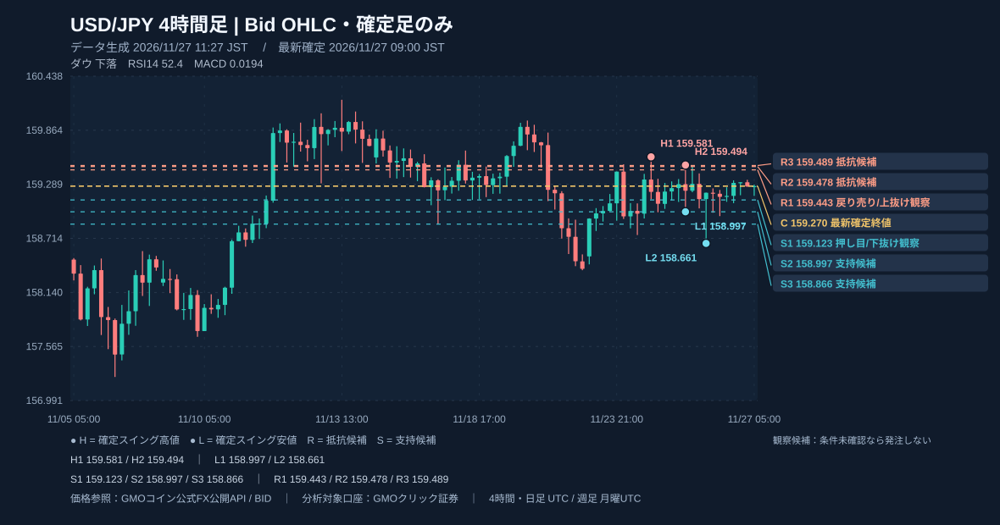

# FX 5時間足 データ確認（2026/11/19 07:56 JST）
取得元：Dukascopy via dukascopy-node (Bid OHLC)。口座情報は未連携。実際の売買価格は各社のBid/Askを使用してください。
確定足のみ使用。4時間足・日足はUTC区切り、週足は月曜日UTCで日足から集計。

## ZAR/JPY（みんなのFX）

**注釈付き4時間足チャート（重要高安値・支持・抵抗を書き込み）**

**全5時間足の注釈チャート**：[15分](./charts/zarjpy_m15.svg) / [1時間](./charts/zarjpy_h1.svg) / [4時間](./charts/zarjpy_h4.svg) / [日足](./charts/zarjpy_d1.svg) / [週足](./charts/zarjpy_w1.svg)
- m15：最新確定 2026/11/19 07:45 JST、終値 9.2000、ダウ 混在・転換・レンジ、RSI14 36.3、MACD -0.0119 / signal -0.0122、直近高値 9.2190 / 9.2250、直近安値 9.2160 / 9.2070、支持候補 、抵抗候補 9.2190 / 9.2250 / 9.2380
- h1：最新確定 2026/11/19 07:00 JST、終値 9.2250、ダウ 下落、RSI14 23.3、MACD -0.0463 / signal -0.0402、直近高値 9.4280 / 9.3900、直近安値 9.2150 / 9.2070、支持候補 9.2150 / 9.2070、抵抗候補 9.3900 / 9.3960 / 9.3990
- h4：最新確定 2026/11/19 05:00 JST、終値 9.2140、ダウ 下落、RSI14 16.0、MACD -0.0494 / signal -0.0343、直近高値 9.4340 / 9.4280、直近安値 9.3730 / 9.3700、支持候補 、抵抗候補 9.4280 / 9.4340 / 9.4730
- d1：最新確定 2026/11/18 09:00 JST、終値 9.4240、ダウ 下落、RSI14 42.0、MACD -0.0250 / signal -0.0085、直近高値 9.6800 / 9.6660、直近安値 9.3940 / 9.3850、支持候補 9.4200 / 9.4000 / 9.3940、抵抗候補 9.5190 / 9.5870 / 9.5980
- w1：最新確定 2026/11/16 09:00 JST、終値 9.4300、ダウ 下落、RSI14 44.6、MACD -0.0376 / signal 0.0039、直近高値 10.0120 / 10.0000、直近安値 9.4200 / 9.4000、支持候補 9.4200 / 9.4000 / 9.2830、抵抗候補 9.7730 / 9.8810 / 9.8920

## USD/JPY（GMOクリック証券）

**注釈付き4時間足チャート（重要高安値・支持・抵抗を書き込み）**

**全5時間足の注釈チャート**：[15分](./charts/usdjpy_m15.svg) / [1時間](./charts/usdjpy_h1.svg) / [4時間](./charts/usdjpy_h4.svg) / [日足](./charts/usdjpy_d1.svg) / [週足](./charts/usdjpy_w1.svg)
- m15：最新確定 2026/11/19 07:45 JST、終値 159.307、ダウ 混在・転換・レンジ、RSI14 47.7、MACD 0.005 / signal 0.008、直近高値 159.402 / 159.391、直近安値 159.239 / 159.264、支持候補 159.300 / 159.296 / 159.292、抵抗候補 159.321 / 159.323 / 159.325
- h1：最新確定 2026/11/19 07:00 JST、終値 159.337、ダウ 混在・転換・レンジ、RSI14 50.7、MACD -0.007 / signal -0.011、直近高値 159.478 / 159.402、直近安値 159.123 / 159.155、支持候補 159.334 / 159.308 / 159.155、抵抗候補 159.365 / 159.365 / 159.402
- h4：最新確定 2026/11/19 05:00 JST、終値 159.354、ダウ 混在・転換・レンジ、RSI14 46.3、MACD -0.050 / signal -0.032、直近高値 159.890 / 159.650、直近安値 158.866 / 159.123、支持候補 159.348 / 159.308 / 159.123、抵抗候補 159.398 / 159.444 / 159.489
- d1：最新確定 2026/11/18 09:00 JST、終値 159.511、ダウ 上昇、RSI14 61.2、MACD 0.515 / signal 0.406、直近高値 158.766 / 160.189、直近安値 157.253 / 157.669、支持候補 157.701 / 157.669 / 157.548、抵抗候補 159.565 / 159.778 / 160.189
- w1：最新確定 2026/11/16 09:00 JST、終値 159.789、ダウ 混在・転換・レンジ、RSI14 55.3、MACD -0.092 / signal -0.121、直近高値 159.034 / 158.948、直近安値 152.889 / 156.074、支持候補 156.074 / 155.225 / 155.029、抵抗候補 160.392 / 160.460 / 160.723

口座残高・建玉・必要証拠金・ロスカット水準は自動取得しません。
